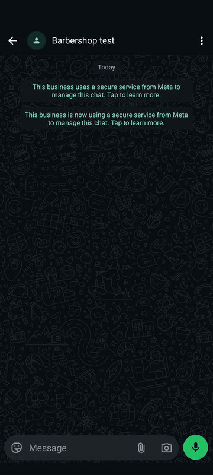

# Assistantfy

AI agent capable of managing all client bookings, cancelling appointments, and answering questions about schedules and services while keeping the data reliable.

## 📦 Technologies

* Python
* FastAPI
* PostgreSQL
* Redis
* Vite
* React.js
* TypeScript
* Docker

## 🦄 Features

Here's what you can do with Assistantfy:

* As a client, you can chat via WhatsApp in order to book and cancel an appointment, as well as get your questions answered (schedules, services...).

* As a business owner, you can: 

- configure your business (workers, services, worker-service assignments, and business hours).

- check  your appointments (filter by name, worker and status) and modify your appointments (booked, completed, no show, cancelled)

## 📚 What I Learned

Maybe it's difficult to put into words everything I have learned while developing this project:

* Learned how to use new technologies such as FastAPI, PostgreSQL, React, TypeScript, Docker, Redis and Git.

* How to consume AI through APIs, how to keep the context of the model through the conversation, prompting and how to create an agent loop so AI could have access to tools.

* Consume the WhatsApp API and send messages with background tasks (from FastAPI).

It's a little bit of a vague and short description because this project changed the way I think about the quality of the software I am building. I have had my ups and downs with the project, but I have consistently kept pushing and learning, which was the objective.

## 🚦 Running the Project

1. Clone the repo and install the backend dependencies: `pip install -r backend/requirements.txt`.

2. Copy `.env.example` to `.env` and fill it in. The Meta values must come from the **same** WhatsApp Cloud API app, or Meta returns `403` on incoming and `code 100` on outgoing.

3. `docker compose up -d`, then create your admin and business: `docker compose exec api python -m app.scripts.create_admin`.

4. Expose the API on public HTTPS (ngrok works) and register `<public-url>/webhook` in Meta → WhatsApp → Configuration with the same verify token and the `messages` field subscribed. Set the business `phone_number` in the DB to the `display_phone_number` Meta reports.

5. Message that number from WhatsApp (client side) or open http://localhost:5173 (owner side).

> Use a System User token (the default one expires in 24 h). After any `.env` change run `docker compose up -d --force-recreate api`; `restart` keeps the old environment.

## 🍿 Video

### Business owner perspective 

### Client perspective 

